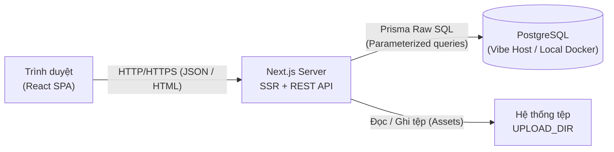
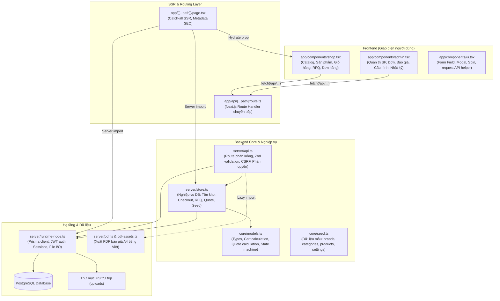
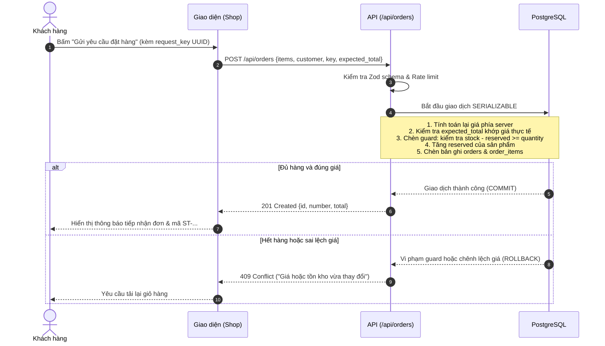
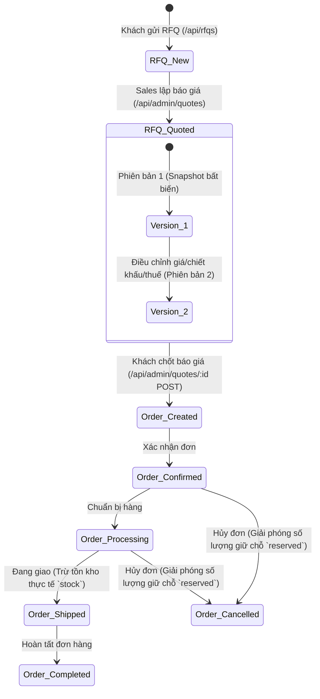

# Kiến trúc hệ thống SpaceTech

Tài liệu này mô tả kiến trúc tổng thể, luồng dữ liệu, phân lớp mã nguồn và các quyết định thiết kế quan trọng của ứng dụng SpaceTech.

## 1. Tổng quan

SpaceTech là ứng dụng thương mại điện tử B2B dành cho thiết bị tự động hóa công nghiệp (PLC, HMI, Biến tần, Cảm biến, Servo, Khởi động từ...). Ứng dụng kết hợp giữa mô hình mua hàng niêm yết và quy trình yêu cầu báo giá B2B (RFQ/Báo giá nhiều phiên bản xuất PDF).

- **Mô hình render**: SPA với Server-Side Rendering (SSR) lần đầu. Trang đầu tiên được render HTML hoàn chỉnh kèm dữ liệu khởi tạo trên server để tối ưu SEO, sau đó React hydrate và quản lý định tuyến client-side.
- **Backend**: Next.js App Router (Route Handlers `/api/[...path]`).
- **Database**: PostgreSQL với các giao dịch ACID (mức cô lập `SERIALIZABLE` cho luồng đặt hàng).

---

## 2. Phân lớp kiến trúc mã nguồn

### 2.1. Tầng Giao diện (Frontend)
- **`app/components/shop.tsx`**: Đảm nhiệm toàn bộ trải nghiệm khách hàng:
  - Xem danh mục, thương hiệu, tìm kiếm mã SKU, part number.
  - Lọc đa thuộc tính kỹ thuật (điện áp, tín hiệu ngõ ra, công suất, giao thức truyền thông).
  - Giỏ hàng lưu tạm ở `localStorage`, kiểm tra giá/tồn từ máy chủ khi checkout.
  - Gửi yêu cầu đặt hàng và yêu cầu báo giá B2B (RFQ).
  - Tra cứu thông tin đơn hàng và tài khoản cá nhân.
- **`app/components/admin.tsx`**: Cổng quản trị phân quyền cho nhân sự:
  - Quản lý sản phẩm (thêm/sửa, thông số kỹ thuật `specs`, tải ảnh/datasheet, kiểm soát tồn kho và giữ chỗ `reserved`).
  - Xử lý đơn hàng (chuyển đổi trạng thái theo quy trình: mới → xác nhận → chuẩn bị → đang giao → hoàn tất / hủy).
  - Báo giá B2B: chuyển RFQ thành báo giá chi tiết từng dòng, tính thuế/chiết khấu/phí vận chuyển, phát hành phiên bản bất biến, xuất PDF và chuyển đổi thành đơn hàng.
  - Quản trị danh mục & thương hiệu phân cấp.
  - Cấu hình website (thông tin liên hệ, hotline, SEO, chính sách).
  - Nhật ký thao tác (Audit log).
- **`app/components/ui.tsx`**: Các thành phần UI nguyên tử (Input, Field, Select, Modal, Badge, Loading Spinner) và hàm tiện ích `request()` dùng `fetch` có xử lý lỗi đồng nhất.

### 2.2. Tầng Trang & Server-Side Rendering (Page / SSR)
- **`app/[[...path]]/page.tsx`**: Trang nhận mọi đường dẫn URL frontend (catch-all).
  - Thực thi hoàn toàn ở máy chủ (`dynamic = "force-dynamic"`).
  - Truy vấn đồng thời: cấu hình (`settings`), danh mục sản phẩm (`products`), cây phân loại (`taxonomy`), bài viết (`articles`) và thông tin người dùng đang đăng nhập (`actor`).
  - Sinh Metadata động (`generateMetadata`) theo ngữ cảnh URL cho Google Search Console, OpenGraph và chuẩn SEO.
  - Truyền prop `initial` sang component `<Shop />` để render giao diện ngay lập tức mà không có độ trễ tải dữ liệu ban đầu.

### 2.3. Tầng API & Phân quyền (Backend API)
- **`app/api/[...path]/route.ts`**: Chuyển tiếp toàn bộ HTTP methods (`GET`, `POST`, `PATCH`, `DELETE`) vào bộ xử lý tập trung `api(req)` tại `server/api.ts`.
- **`server/api.ts`**:
  - **CSRF Protection**: Chặn mọi yêu cầu biến đổi trạng thái (`POST`, `PATCH`, `DELETE`) từ cross-site qua tiêu đề `sec-fetch-site` và `origin`.
  - **Rate Limiting**: Giới hạn tần suất gọi API nhạy cảm (đăng nhập, tạo đơn hàng, đăng ký) sử dụng bảng `rate_limits`.
  - **Schema Validation**: Dùng Zod để kiểm tra tính hợp lệ của dữ liệu đầu vào.
  - **Phân quyền truy cập theo vai trò**:
    - `admin`: Toàn quyền quản trị hệ thống.
    - `sales`: Quản lý đơn hàng, báo giá RFQ, xem sản phẩm.
    - `technician`: Thêm/sửa thông số sản phẩm, quản lý bài viết kỹ thuật; bị khóa quyền sửa giá, kho và trạng thái.
    - `customer`: Xem thông tin tài khoản, đơn hàng và báo giá của chính mình.

### 2.4. Tầng Xử lý Nghiệp vụ & Dữ liệu (Business & Store)
- **`server/store.ts`**: Thực hiện toàn bộ logic truy vấn và giao dịch cơ sở dữ liệu:
  - Cơ chế **Guard Table**: Sử dụng bảng `guards` với ràng buộc `CHECK (ok = 1)` để kiểm tra điều kiện tồn kho và trạng thái trong cùng một giao dịch batch nguyên tử.
  - **SERIALIZABLE Isolation**: Các giao dịch tạo đơn hàng hoặc trừ kho được thực thi ở mức cô lập cao nhất, có cơ chế retry tự động khi gặp xung đột serialization.
- **`core/models.ts`**: Định nghĩa kiểu dữ liệu toàn hệ thống (`Product`, `Actor`, `Role`, `Spec`, `Row`, `Sql`), logic tính tiền giỏ hàng (`calculateCart`), tính toán báo giá (`calculateQuote`), và máy trạng thái đơn hàng (`transitions`).
- **`server/runtime-node.ts`**: Lớp trừu tượng hạ tầng Node.js:
  - Khởi tạo `PrismaClient` và chuyển đổi query parameterized `?` sang `$1, $2...` của PostgreSQL.
  - Xác thực phiên bằng JSON Web Token (JWT) mã hóa HS256 kết hợp bảng `sessions`.
  - Quản lý tải lên tệp: kiểm tra magic bytes (PNG, JPEG, WebP, PDF) và ghi vào filesystem cục bộ theo `UPLOAD_DIR`.
  - Định danh phạm vi lưu trữ: `scope = "shop"`.

---

## 3. Luồng dữ liệu và quy trình nghiệp vụ chính

### 3.1. Luồng Đặt hàng & Đảm bảo Tính nhất quán Tồn kho

### 3.2. Luồng Báo giá B2B (RFQ → Quote → Order)

---

## 4. Bảo mật và Thiết kế bền vững

1. **Bảo vệ chống bán vượt tồn (Overselling Protection)**:
   - Tồn khả dụng tính theo công thức: `Khả dụng = stock - reserved`.
   - Khi tạo đơn mới: tăng `reserved`.
   - Khi xuất kho giao hàng (`shipped`): trừ `stock` thực tế và trừ `reserved`.
   - Khi hủy đơn trước khi giao (`cancelled`): hoàn trả lại `reserved`.
2. **Idempotency (Chống trùng lặp yêu cầu)**:
   - Mỗi yêu cầu checkout mang một `request_key` (UUID do client sinh ra).
   - Nếu client bị ngắt mạng và gửi lại cùng key, hệ thống trả về kết quả đơn đã tạo trước đó thay vì tạo đơn thứ hai.
3. **Snapshot Báo giá Bất biến**:
   - Dữ liệu người bán, thông tin khách hàng, chi tiết giá từng mã hàng được snapshot thành chuỗi JSON bất biến trong bảng `quotes`.
   - Thay đổi thông tin sản phẩm hoặc cấu hình cửa hàng trong tương lai không làm thay đổi các báo giá và file PDF đã phát hành.
4. **An toàn tập tin tải lên**:
   - Chỉ cho phép các định dạng: PNG, JPEG, WebP, PDF (giới hạn tối đa 10 MB).
   - Kiểm tra magic bytes thực tế ở đầu tệp, không tin cậy `Content-Type` do client gửi.
5. **Cách ly dữ liệu theo Scope**:
   - Mọi bảng đều có trường `scope`.
   - Mọi câu truy vấn đều ràng buộc `WHERE scope = ?` giúp cách ly an toàn dữ liệu giữa các môi trường hoặc đa người thuê.
