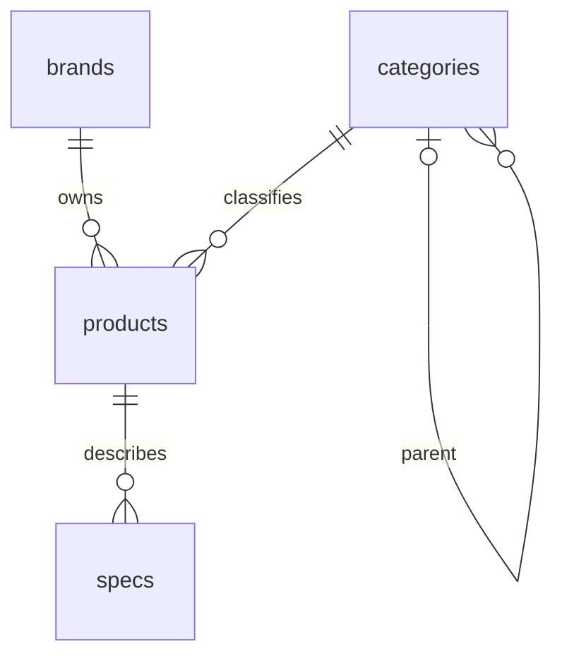
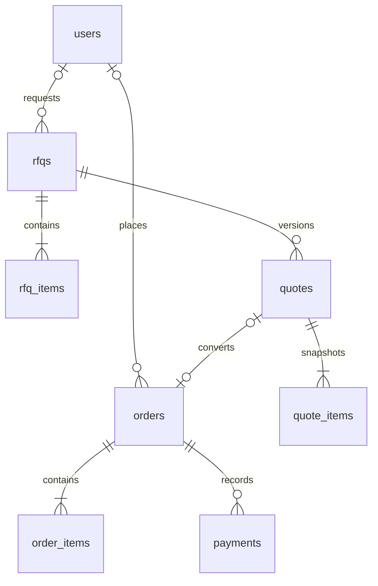

# Thiết kế cơ sở dữ liệu

Bản vận hành: PostgreSQL. Schema thực thi đầy đủ nằm trong `prisma/migrations/20261107_initial/migration.sql`; `prisma/schema.prisma` mô tả kiểu dữ liệu. Bản chạy thử dùng D1 (SQLite), migration `drizzle/0000_large_jack_murdock.sql`. Không dùng NoSQL vì giá, tồn kho, đơn và báo giá cần giao dịch nguyên tử.

## Danh mục và thiết bị

## Đơn hàng và báo giá

Các đường trong sơ đồ gồm cả liên kết logic. Migration PostgreSQL khai báo FK cho product → brand/category, specs → product, session → user, các bảng item → cha/product, quote → RFQ và payment → order. Liên kết category.parent_id, orders.user_id/quote_id, rfqs.user_id được kiểm soát trong nghiệp vụ; chưa có FK cho các trường này. Bản D1 kiểm tra quan hệ/phạm vi trong API, không khai báo FK. Với vận hành lớn cần tăng ràng buộc tương ứng và quản trị migration.

## Quy tắc lưu trữ

- Mọi bảng có `id TEXT PRIMARY KEY` và `scope TEXT NOT NULL`. Node sử dụng scope `shop`; bản thử dùng `preview:<id danh tính>`.
- Tiền VND dùng `DECIMAL(18,0)` ở PostgreSQL; SQLite dùng số nguyên. Backend từ chối tổng vượt giới hạn số nguyên an toàn JavaScript. Thuế suất lưu số phần trăm, làm tròn tiền thuế từng dòng sau giảm giá.
- Thời gian lưu BIGINT (Unix milliseconds), hiển thị theo định dạng Việt Nam.
- Bảng specs lưu giá trị trình bày cùng min/max/number; không cắt bỏ đơn vị khỏi dữ liệu mô tả. `voltage.min/max` là dải điện áp cấp nguồn.
- `stock` là tồn thực tế; `reserved` là phần đã giữ cho đơn chưa giao; khả dụng = stock - reserved. CHECK không âm và reserved ≤ stock.
- Snapshot khách, người bán, điều khoản và các dòng giá của báo giá không đổi khi sản phẩm/cửa hàng được sửa.
- Giỏ hàng chỉ lưu ID và số lượng trong localStorage. Giá và tồn được lấy lại từ server.
- Tệp nằm ở R2 hoặc filesystem volume. `assets` chỉ lưu metadata/key; không nhét PDF vào bảng products.
- Settings/customer/seller lưu chuỗi JSON để dùng chung hai adapter. Truy vấn quan trọng không dựa vào tìm kiếm trong chuỗi JSON.

## Khóa duy nhất và chỉ mục

`products(scope,sku)` và `(scope,slug)`; brands/categories/articles `(scope,slug)`; users `(scope,email)`; orders `(scope,request_key)`, `(scope,quote_id)` và `(scope,number)`; quotes `(scope,number,version)`; events `(scope,provider,event_id)`.

PostgreSQL có chỉ mục `products(scope,part_search)`, `specs(scope,key,value)`, `orders(scope,status,created)`. Tìm kiếm hiện chạy bộ dữ liệu catalog ở tầng ứng dụng; các index này chuẩn bị cho mở rộng SQL phân trang.

## Tính nhất quán

Checkout tính giá từ server, giữ tồn và tạo đơn/item trong cùng giao dịch. `guards` có CHECK `ok=1`; một điều kiện tồn/giá/trạng thái không còn đúng làm cả batch rollback. Node dùng SERIALIZABLE và retry lỗi serialization. D1 dùng atomic batch.

Request UUID khiến việc bấm lại / retry không tạo hai đơn. quote_id duy nhất khiến một phiên bản báo giá chỉ chuyển thành một đơn. Mỗi phiên bản báo giá của một RFQ có số phiên bản duy nhất. Lưu sản phẩm kiểm tra tồn/updated để tránh ghi đè thay đổi đồng thời.

## Các bảng và trường thực thi

### brands

| Trường | Kiểu / ràng buộc |
| --- | --- |
| `id` | TEXT PRIMARY KEY |
| `scope` | TEXT NOT NULL |
| `name` | TEXT NOT NULL |
| `slug` | TEXT NOT NULL |

### categories

| Trường | Kiểu / ràng buộc |
| --- | --- |
| `id` | TEXT PRIMARY KEY |
| `scope` | TEXT NOT NULL |
| `name` | TEXT NOT NULL |
| `slug` | TEXT NOT NULL |
| `parent_id` | TEXT |

### products

| Trường | Kiểu / ràng buộc |
| --- | --- |
| `id` | TEXT PRIMARY KEY |
| `scope` | TEXT NOT NULL |
| `name` | TEXT NOT NULL |
| `slug` | TEXT NOT NULL |
| `sku` | TEXT NOT NULL |
| `part_number` | TEXT NOT NULL |
| `part_search` | TEXT NOT NULL |
| `brand_id` | TEXT NOT NULL |
| `category_id` | TEXT NOT NULL |
| `description` | TEXT NOT NULL |
| `image` | TEXT NOT NULL |
| `datasheet` | TEXT NOT NULL |
| `source` | TEXT NOT NULL |
| `mode` | TEXT NOT NULL |
| `price` | DECIMAL(18,0) |
| `stock` | INTEGER NOT NULL |
| `reserved` | INTEGER NOT NULL |
| `backorder` | INTEGER NOT NULL |
| `demo` | INTEGER NOT NULL |
| `status` | TEXT NOT NULL |
| `created` | BIGINT NOT NULL |
| `updated` | BIGINT NOT NULL |

### specs

| Trường | Kiểu / ràng buộc |
| --- | --- |
| `id` | TEXT PRIMARY KEY |
| `scope` | TEXT NOT NULL |
| `product_id` | TEXT NOT NULL |
| `key` | TEXT NOT NULL |
| `label` | TEXT NOT NULL |
| `value` | TEXT NOT NULL |
| `unit` | TEXT NOT NULL |
| `number` | DOUBLE PRECISION |
| `min` | DOUBLE PRECISION |
| `max` | DOUBLE PRECISION |

### settings

| Trường | Kiểu / ràng buộc |
| --- | --- |
| `id` | TEXT PRIMARY KEY |
| `scope` | TEXT NOT NULL |
| `value` | TEXT NOT NULL |

### users

| Trường | Kiểu / ràng buộc |
| --- | --- |
| `id` | TEXT PRIMARY KEY |
| `scope` | TEXT NOT NULL |
| `name` | TEXT NOT NULL |
| `email` | TEXT NOT NULL |
| `password_hash` | TEXT NOT NULL |
| `role` | TEXT NOT NULL |
| `status` | TEXT NOT NULL |
| `created` | BIGINT NOT NULL |

### sessions

| Trường | Kiểu / ràng buộc |
| --- | --- |
| `id` | TEXT PRIMARY KEY |
| `scope` | TEXT NOT NULL |
| `user_id` | TEXT NOT NULL |
| `expires` | BIGINT NOT NULL |

### orders

| Trường | Kiểu / ràng buộc |
| --- | --- |
| `id` | TEXT PRIMARY KEY |
| `scope` | TEXT NOT NULL |
| `number` | TEXT NOT NULL |
| `user_id` | TEXT |
| `customer` | TEXT NOT NULL |
| `status` | TEXT NOT NULL |
| `payment_status` | TEXT NOT NULL |
| `method` | TEXT NOT NULL |
| `subtotal` | DECIMAL(18,0) NOT NULL |
| `shipping` | DECIMAL(18,0) NOT NULL |
| `tax` | DECIMAL(18,0) NOT NULL |
| `total` | DECIMAL(18,0) NOT NULL |
| `request_key` | TEXT NOT NULL |
| `quote_id` | TEXT |
| `created` | BIGINT NOT NULL |

### order_items

| Trường | Kiểu / ràng buộc |
| --- | --- |
| `id` | TEXT PRIMARY KEY |
| `scope` | TEXT NOT NULL |
| `order_id` | TEXT NOT NULL |
| `product_id` | TEXT NOT NULL |
| `name` | TEXT NOT NULL |
| `part_number` | TEXT NOT NULL |
| `quantity` | INTEGER NOT NULL |
| `price` | DECIMAL(18,0) NOT NULL |
| `tax` | DOUBLE PRECISION NOT NULL |
| `discount` | DECIMAL(18,0) NOT NULL |
| `total` | DECIMAL(18,0) NOT NULL |
| `reserve` | INTEGER NOT NULL |

### rfqs

| Trường | Kiểu / ràng buộc |
| --- | --- |
| `id` | TEXT PRIMARY KEY |
| `scope` | TEXT NOT NULL |
| `number` | TEXT NOT NULL |
| `user_id` | TEXT |
| `customer` | TEXT NOT NULL |
| `status` | TEXT NOT NULL |
| `note` | TEXT NOT NULL |
| `created` | BIGINT NOT NULL |

### rfq_items

| Trường | Kiểu / ràng buộc |
| --- | --- |
| `id` | TEXT PRIMARY KEY |
| `scope` | TEXT NOT NULL |
| `rfq_id` | TEXT NOT NULL |
| `product_id` | TEXT |
| `name` | TEXT NOT NULL |
| `part_number` | TEXT NOT NULL |
| `quantity` | INTEGER NOT NULL |
| `note` | TEXT NOT NULL |

### quotes

| Trường | Kiểu / ràng buộc |
| --- | --- |
| `id` | TEXT PRIMARY KEY |
| `scope` | TEXT NOT NULL |
| `number` | TEXT NOT NULL |
| `rfq_id` | TEXT NOT NULL |
| `version` | INTEGER NOT NULL |
| `customer` | TEXT NOT NULL |
| `seller` | TEXT NOT NULL |
| `status` | TEXT NOT NULL |
| `subtotal` | DECIMAL(18,0) NOT NULL |
| `shipping` | DECIMAL(18,0) NOT NULL |
| `tax` | DECIMAL(18,0) NOT NULL |
| `discount` | DECIMAL(18,0) NOT NULL |
| `total` | DECIMAL(18,0) NOT NULL |
| `valid_until` | BIGINT NOT NULL |
| `terms` | TEXT NOT NULL |
| `created` | BIGINT NOT NULL |

### quote_items

| Trường | Kiểu / ràng buộc |
| --- | --- |
| `id` | TEXT PRIMARY KEY |
| `scope` | TEXT NOT NULL |
| `quote_id` | TEXT NOT NULL |
| `product_id` | TEXT |
| `name` | TEXT NOT NULL |
| `part_number` | TEXT NOT NULL |
| `quantity` | INTEGER NOT NULL |
| `price` | DECIMAL(18,0) NOT NULL |
| `tax` | DOUBLE PRECISION NOT NULL |
| `discount` | DECIMAL(18,0) NOT NULL |
| `total` | DECIMAL(18,0) NOT NULL |
| `lead_time` | TEXT NOT NULL |
| `warranty` | TEXT NOT NULL |

### assets

| Trường | Kiểu / ràng buộc |
| --- | --- |
| `id` | TEXT PRIMARY KEY |
| `scope` | TEXT NOT NULL |
| `key` | TEXT NOT NULL |
| `name` | TEXT NOT NULL |
| `mime` | TEXT NOT NULL |
| `size` | INTEGER NOT NULL |
| `owner_id` | TEXT NOT NULL |
| `created` | BIGINT NOT NULL |

### articles

| Trường | Kiểu / ràng buộc |
| --- | --- |
| `id` | TEXT PRIMARY KEY |
| `scope` | TEXT NOT NULL |
| `slug` | TEXT NOT NULL |
| `title` | TEXT NOT NULL |
| `excerpt` | TEXT NOT NULL |
| `body` | TEXT NOT NULL |
| `category` | TEXT NOT NULL |
| `image` | TEXT NOT NULL |
| `status` | TEXT NOT NULL |
| `created` | BIGINT NOT NULL |

### payments

| Trường | Kiểu / ràng buộc |
| --- | --- |
| `id` | TEXT PRIMARY KEY |
| `scope` | TEXT NOT NULL |
| `order_id` | TEXT NOT NULL |
| `provider` | TEXT NOT NULL |
| `reference` | TEXT NOT NULL |
| `amount` | DECIMAL(18,0) NOT NULL |
| `created` | BIGINT NOT NULL |

### events

| Trường | Kiểu / ràng buộc |
| --- | --- |
| `id` | TEXT PRIMARY KEY |
| `scope` | TEXT NOT NULL |
| `provider` | TEXT NOT NULL |
| `event_id` | TEXT NOT NULL |
| `created` | BIGINT NOT NULL |

### audit

| Trường | Kiểu / ràng buộc |
| --- | --- |
| `id` | TEXT PRIMARY KEY |
| `scope` | TEXT NOT NULL |
| `actor_id` | TEXT NOT NULL |
| `action` | TEXT NOT NULL |
| `entity` | TEXT NOT NULL |
| `created` | BIGINT NOT NULL |

### guards

| Trường | Kiểu / ràng buộc |
| --- | --- |
| `id` | TEXT PRIMARY KEY |
| `scope` | TEXT NOT NULL |
| `ok` | INTEGER NOT NULL |

### rate_limits

| Trường | Kiểu / ràng buộc |
| --- | --- |
| `id` | TEXT PRIMARY KEY |
| `scope` | TEXT NOT NULL |
| `count` | INTEGER NOT NULL |
| `expires` | BIGINT NOT NULL |

Bảng và cột thanh toán cũ được giữ để bảo toàn dữ liệu lịch sử. Phiên bản hiện tại ghi đơn mới với `method=request` và `payment_status=not_applicable` và không mở endpoint thu tiền.
